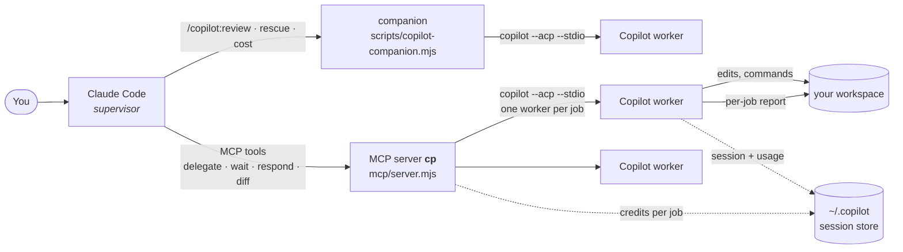
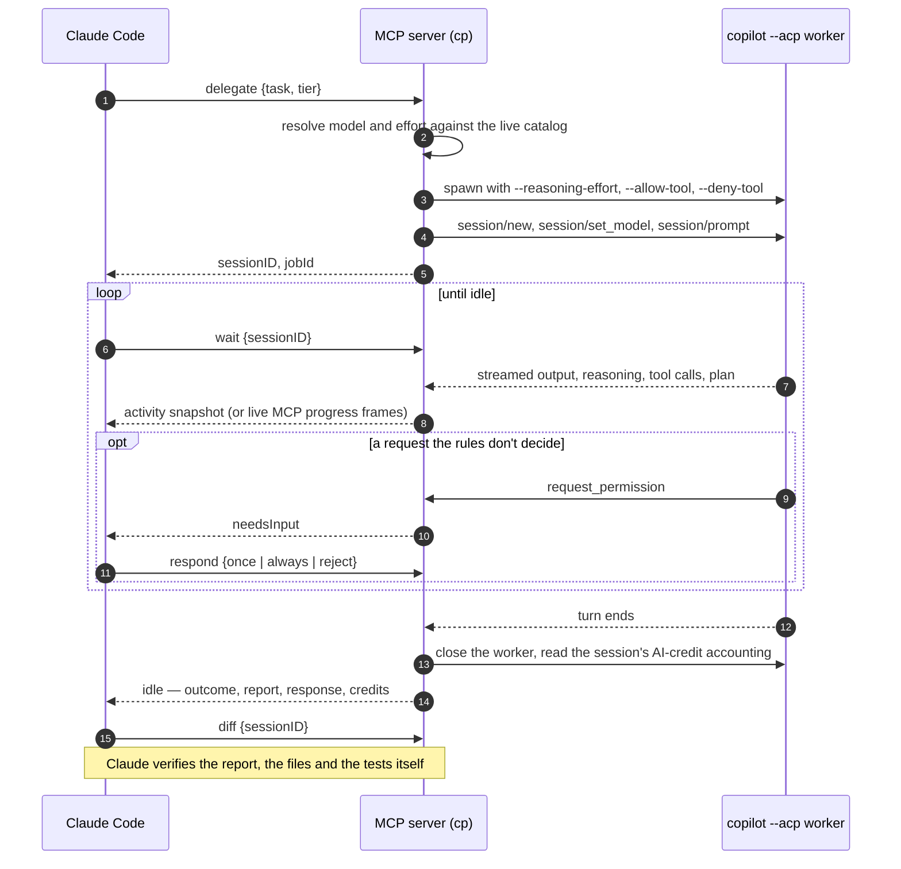

<h1 align="center">GitHub Copilot CLI for Claude Code</h1>

<p align="center">
  <b>Delegate coding tasks to GitHub Copilot CLI workers, supervise them live, and verify the result — without leaving Claude Code.</b>
</p>

<p align="center">
  <a href="https://github.com/naicud/copilotcli-plugin-cc/actions/workflows/test.yml"></a>
  
  
  
  = 18.18">
  
  <a href="LICENSE"></a>
</p>

<p align="center">
  
</p>
<p align="center"><sub>A real recorded run (Copilot CLI 1.0.102, <code>claude-haiku-5.5</code>, 0.56 AI credits) — regenerate it with <code>npm run demo</code>.</sub></p>

Claude stays the supervisor. Every delegated job runs in its own `copilot --acp` worker — the Copilot CLI speaking the [Agent Client Protocol](https://agentclientprotocol.com) — with its own model, reasoning effort and tool rules. Claude shapes the task, answers the permission requests Copilot cannot decide alone, and checks the work before it trusts it. The AI credits each job costs are recorded from Copilot's own accounting.

## Quick start

```bash
# 1. inside Claude Code: install the plugin
/plugin marketplace add naicud/copilotcli-plugin-cc
/plugin install copilot@naicud-copilotcli-plugin-cc
/reload-plugins

# 2. check Copilot CLI and your login (offers to install the CLI if it is missing)
/copilot:setup

# 3. use it
/copilot:delegate --tier 0 add unit tests for src/slugify.js and make npm test pass
/copilot:review
/copilot:cost
```

Not signed in to Copilot yet? Run `! copilot login` once.

## What you get

| | |
|---|---|
| **Delegation with supervision** | `/copilot:delegate`, `/copilot:parallel` (up to 12 workers, or a race), `/copilot:test`. While a worker runs you see its output, reasoning, tool calls and plan; when it finishes, Claude reads its report, checks the diff and re-runs the tests. |
| **Code review by Copilot** | `/copilot:review` and `/copilot:adversarial-review` on the working tree (staged, unstaged and new files) or a branch, answered as structured findings. |
| **Rescue** | `/copilot:rescue` hands a stuck investigation or fix to Copilot, in the foreground or the background, and can resume the same Copilot session later. |
| **Models that match your account** | Tiers 0–3 resolve against the live catalog your Copilot plan offers, with each model's premium multiplier (0.33x, 1x, 15x…). `/copilot:model` edits tiers, defaults, exclusions and effort safely. |
| **Credits under control** | Every job records the AI credits and premium requests Copilot billed for it; `/copilot:cost` breaks them down, and daily caps can stop new delegations. |
| **Optional stop gate** | Copilot reviews Claude's last turn before the session may stop. |

## How it works



A delegation, step by step:



## Requirements

- Claude Code
- [GitHub Copilot CLI](https://github.com/github/copilot-cli) with ACP support, on `PATH` as `copilot` — `npm install -g @github/copilot` or `brew install --cask copilot-cli` (verified with 1.0.102; `doctor` warns on older releases)
- A GitHub account with a Copilot plan, signed in with `copilot login` (or `COPILOT_GITHUB_TOKEN`)
- Node.js 18.18 or later — the plugin has no npm dependencies

## Install

The marketplace commands in [Quick start](#quick-start) are the normal way. The one-line installer does the same from a terminal:

```bash
! curl -fsSL https://raw.githubusercontent.com/naicud/copilotcli-plugin-cc/main/install.sh | bash
```

`/copilot:setup` then reports the CLI version, who Copilot is signed in as, and the default delegation model once the catalog is known. The MCP `doctor` tool goes further: it opens a real ACP session, reads the model catalog, and checks that the default model resolves.

To remove it: `/plugin uninstall copilot@naicud-copilotcli-plugin-cc`. Plugin state lives in Claude Code's plugin data directory (or `/tmp/copilot-companion` when that is not set); delegated workspaces keep their `.cp-reports/` until the hygiene sweep removes old reports.

## Slash commands

| Command | What it does |
|---|---|
| `/copilot:setup` | Check the CLI, the login and the default model; toggle the review gate (`--enable-review-gate` / `--disable-review-gate`) |
| `/copilot:delegate [--model id] [--tier N] [--effort level] [--reviewer] [--auto-retry] <task>` | Delegate one task and supervise it to a verified result |
| `/copilot:parallel [--race] [flags] <task1> ;; <task2>` | Fan out up to 12 tasks (race mode keeps the first clean finisher and aborts the rest) |
| `/copilot:test [extra]` | Delegate a quick build/test smoke run on tier 0 and report what it touched |
| `/copilot:review [--base ref] [--model id] [--effort level]` | Copilot review of the working tree (staged, unstaged and new files) or of `base...HEAD` |
| `/copilot:adversarial-review [--base ref] [focus]` | A review that challenges the design, with optional focus text |
| `/copilot:rescue [--background\|--wait] [--resume\|--fresh] [--model id] [--effort level] [--read-only] <request>` | Forward an investigation or fix to Copilot |
| `/copilot:status` · `/copilot:result [job]` · `/copilot:cancel [job]` | Inspect, read and cancel jobs of this workspace |
| `/copilot:logs [job\|session] [lines]` | Activity log of a delegated job |
| `/copilot:cost [--html [path]]` | AI credits and premium requests by day, model and job type, with budget headroom |
| `/copilot:model [list\|tier\|default\|exclude\|include\|effort\|check]` | Edit model tiers, the default model, exclusions and effort |

## Delegation tools (MCP)

The MCP server is `cp`; Claude Code exposes its tools as `mcp__plugin_copilot_cp__<tool>`.

| Tool | Purpose |
|---|---|
| `models` | Selectable models (tier, multiplier, price category), effort policy, a selection hint, today's budget |
| `delegate` | Start a job; returns `sessionID` / `jobId` immediately |
| `fanOut` | Start up to 12 jobs with one model and effort; `mode:"race"` aborts the losers |
| `wait` / `waitAll` | Supervise until `idle`, `needsInput` or `retried`. Each call returns a 60 s activity slice — or blocks and streams MCP progress frames when the client sends a progress token |
| `status` | Snapshot: current turn, recent tool calls, todos, pending permissions, context usage; without a session, the recent jobs |
| `logs` | The job's activity log: assistant text, reasoning, tool calls, permission decisions, lifecycle |
| `diff` | What the worker changed since the job started: tracked diff plus every new file |
| `respond` | Answer a pending permission: `once`, `always` or `reject` |
| `abort` | Cancel a running job; the Copilot session stays resumable |
| `shutdown` | Stop this plugin's workers (identity-checked); optionally delete finished Copilot sessions and run the hygiene sweep |
| `doctor` | Environment diagnostics, including a live ACP handshake |

### What the worker is told, and what it may do

The first prompt is a persona preamble, the work contract from `config/models.json` (work only inside the workspace, never commit or push, run the named test command, write the report), your task, and the job's own report path — `.cp-reports/<jobId>.md`, so parallel jobs never overwrite each other.

- **builder** (default) may edit the workspace (`--allow-tool=write`).
- **reviewer** (`persona: "reviewer"`, `--reviewer`) gets no write grant: every edit is rejected except its own report.

Shell commands are decided in three layers. Hard "never" rules — `git push`, `git commit`, `git reset`, `git rebase`, `rm -rf`, `sudo` — go to Copilot as `--deny-tool`: the call fails inside the worker and it carries on with the rest of the task. Known-safe commands (tests, builds, read-only git, `ls`/`cat`/`rg`…) are approved by regex rules. Everything else comes back to Claude as `needsInput`. A `reject` from `respond` ends the worker's current turn — that is how Copilot CLI handles a rejection, and why the hard rules live in `--deny-tool` instead.

### When things go wrong

- A failure carries an `escalation` hint. With `autoRetry: true` the job re-delegates itself: a rate-limit or quota failure moves one tier up, a lost worker or upstream error retries the same model (at most `retryPolicy.maxAutoRetries` times); `wait` then answers `retried` with the new session.
- A builder turn that ends with no output at all is nudged once before it counts as failed.
- A run that finishes without its report is flagged `reportMissing`, so it is never mistaken for a verified success.
- Workers are child processes of the MCP server and stop with it. Their Copilot sessions persist in Copilot's own store, so a job interrupted by a restart reports `WorkerLost` and can be continued with `delegate {resumeSessionID}`.
- `concurrency.maxDelegates` (default 6) caps how many workers run at once — each one is a full Copilot CLI process.

## Models and effort

`config/models.json` defines four tiers as ordered preferences:

| Tier | Use | Shipped preferences |
|---|---|---|
| 0 | cheap mechanical work | `claude-haiku-4.5` (0.33x) |
| 1 | **default**: features, fixes, tests | `claude-sonnet-5.5`, `gpt-6-sol`, `gpt-5.6-terra`, `claude-sonnet-5` |
| 2 | hard refactors and debugging | `gpt-6-astra`, `gpt-5.6-sol` |
| 3 | premium multiplier, last resort | `claude-opus-5.5` (15x) |

At delegation time the first model of the tier that your account has enabled wins. Models the config does not mention stay selectable: their tier is derived from the multiplier (below 1x → tier 0, above 1x → tier 3, 1x by price category). `models` and `/copilot:model list` show the resulting catalog; it comes from Copilot itself and is cached for a few hours (`--refresh` re-reads it).

Reasoning effort (`low`, `medium`, `high`, `xhigh`, `max`) comes from `effortPolicy` — per model, then per tier, then the default (`high`; tier 0 `medium`, tier 3 `max`) — unless a delegation passes `effort` (`off` keeps the model's own default). Change any of it with `/copilot:model`, which validates every edit before writing it.

## Usage and budget

Copilot bills in AI credits and counts premium requests, and records both per session. The plugin copies each job's share onto the job record — the session's totals after the job minus before it, so a resumed session is not counted twice. `/copilot:cost` aggregates them by day, model and job type, and can write a standalone HTML dashboard. Daily caps, checked before a delegation starts:

```json
"budget": { "maxDailyCredits": 50, "maxDailyPremiumRequests": 100 }
```

`null` disables a cap.

## Hooks

- **Delegation router** (`PreToolUse` on `Task`/`Agent`) — flags heavy subagent tasks as candidates for Copilot delegation, with a ready delegate/wait recipe.
- **Delegation context** (`PostToolUse` on `wait`/`waitAll`/`status`) — turns each finished, failed, retried or blocked job into a short instruction for Claude, session by session for `waitAll`.
- **Stop review gate** (`Stop`, off by default) — once enabled with `/copilot:setup --enable-review-gate`, a read-only Copilot review of Claude's last turn runs before the session stops; a `BLOCK` verdict keeps Claude working. It reviews at most once per stop.
- **Session end** — settles jobs whose worker is gone and runs the hygiene sweep.

## Disk hygiene

Nothing is left behind: state lives under the plugin data directory, the activity log is in memory (with a small snapshot for restarts), and a TTL sweep runs at server start, hourly and at session end. It removes workspace state untouched for 14 days (`CP_STATE_TTL_DAYS`, `0` disables) and consumed reports older than 7 days (`CP_REPORT_TTL_DAYS`) — only in workspaces this plugin delegated in, never while a job there is running. The catalog probe deletes the empty Copilot session it opens. `shutdown {deleteSessions: true}` also deletes the Copilot session records of finished delegations.

## Configuration

| Variable | Effect |
|---|---|
| `CP_COPILOT_BIN` | Path to the Copilot CLI (a `.mjs`/`.js` path runs under node — the test suite's fake agent uses this) |
| `CP_MODELS_CONFIG` | Alternative `models.json` |
| `CP_STATE_DIR` | State root (default: Claude Code's plugin data dir, else `/tmp/copilot-companion`) |
| `CP_WAIT_SLICE_SEC` | Length of one `wait` activity slice without a progress token (default 60) |
| `CP_PROGRESS_INTERVAL_MS` | Interval between MCP progress frames (default 8000) |
| `CP_ACTIVITY_LOG=1` | Mirror each job's activity log to a file under the state dir |
| `CP_STATE_TTL_DAYS`, `CP_REPORT_TTL_DAYS` | Hygiene TTLs |
| `COPILOT_HOME` | Copilot's own config and session directory (honoured when reading usage) |

## Testing

```bash
npm test          # unit tests + delegation flows against a fake ACP agent — no credits used
npm run test:e2e  # one live delegation against the real Copilot CLI (claude-haiku-5.5, ~1 AI credit)
npm run demo      # re-record the live run above and regenerate docs/demo.svg
```

The fake agent ([`tests/fixtures/fake-copilot.mjs`](tests/fixtures/fake-copilot.mjs)) speaks the same ACP subset as the CLI and is scripted by `FAKE:` directives in the prompt, so permission asks, denials, cancellation, crashes, empty turns, retries and usage accounting all run through real worker processes, on Linux, macOS and Windows in CI. The protocol facts it mimics were verified against the real CLI and are recorded in [`docs/copilot-acp-findings.md`](docs/copilot-acp-findings.md).

## Limitations

- Copilot CLI's ACP server is in public preview; its behaviour may change between CLI releases (`npm run test:e2e` is the quick check after an upgrade).
- Workers do not survive their MCP server — the Copilot session does, and can be resumed.
- `respond {response: "reject"}` ends the worker's turn.
- Windows is covered by the fake-agent suite in CI but has not been run against the real CLI.

## Ownership & upstream

Forked from [opencode-plugin-cc](https://github.com/naicud/opencode-plugin-cc), which derives from OpenAI's [codex-plugin-cc](https://github.com/openai/codex-plugin-cc). The OpenCode backend is replaced by GitHub Copilot CLI over ACP; supervision, the report contract, hooks, hygiene and the companion architecture carry over. See [NOTICE](NOTICE).

## License

Apache-2.0 — see [LICENSE](LICENSE).
